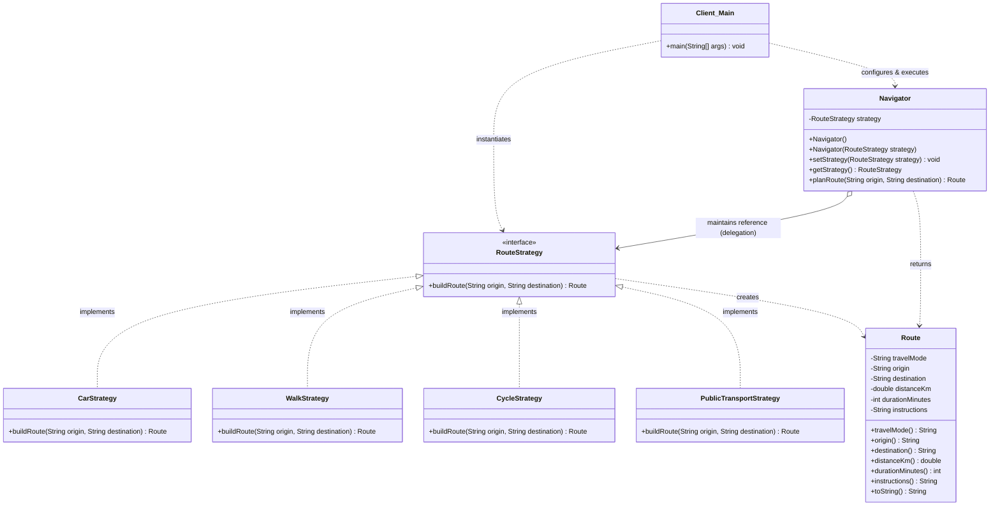

# Assignment #5 — Strategy Pattern Report

**Course:** ShP-2216 – Software Design Patterns (OP 6B06102 – Software Engineering)  
**Academic Year:** 2026–2027 (2nd year, 4th trimester)  
**Institution:** Astana IT University — School of Software Engineering  
**Student:** Nursultan Maratov (Group SE-2523)  
**Topic:** Option A — Navigation / Route Planning  

---

## 1. Introduction

In modern navigation software (such as Google Maps, Apple Maps, or 2GIS), users frequently need to calculate routes between geographical endpoints using varying modes of transportation. While the core client objective remains uniform—calculating an optimal route between an origin and a destination—the underlying routing algorithms, heuristics, road networks, and constraints differ fundamentally based on the transport mode:

- **Motor vehicles (Car):** Prioritize multi-lane highways and avenues, account for traffic congestion, and avoid pedestrian zones.
- **Pedestrians (Walk):** Utilize pedestrian sidewalks, crosswalks, and park trails; avoid high-speed motorways; minimize physical walking distance.
- **Cyclists (Cycle):** Target designated bicycle paths and quiet secondary streets, avoiding steep slopes and dangerous intersections.
- **Public Transit:** Rely on scheduled bus routes and transit hubs with transfer intervals.

To address this problem cleanly without conditional branching antipatterns (`if/else` or `switch` chains), the **Strategy behavioral design pattern** was implemented. It defines a family of interchangeable route calculation algorithms (`CarStrategy`, `WalkStrategy`, `CycleStrategy`, `PublicTransportStrategy`), encapsulates each behind a common interface (`RouteStrategy`), and allows the context (`Navigator`) to switch algorithms dynamically at runtime based on user preference.

---

## 2. UML Class Diagram

### 2.1 Mermaid Diagram



### 2.2 Text / ASCII Architecture Overview

```text
               +----------------------------------+
               |              Client              |
               |       (kz.aitu.strategy.Main)    |
               +-----------------+----------------+
                                 | configures & calls
                                 v
               +----------------------------------+
               |             Context              |
               |    (kz.aitu.strategy.Navigator)  |
               +-----------------+----------------+
                                 | delegates to
                                 v
               +----------------------------------+
               |        <<Strategy Interface>>     |
               |           RouteStrategy          |
               |   +buildRoute(origin, dest)      |
               +-----------------+----------------+
                                 ^
         +-----------------------+-----------------------+-----------------------+
         |                       |                       |                       |
+--------+--------+     +--------+--------+     +--------+--------+     +--------+--------+
|   CarStrategy   |     |  WalkStrategy   |     |  CycleStrategy  |     |PublicTransport- |
| (Avenues/Hwy)   |     | (Parks/Walkway) |     |  (Bicycle lane) |     |    Strategy     |
+-----------------+     +-----------------+     +-----------------+     +-----------------+
```

---

## 3. Clean Code Section

In accordance with Robert C. Martin's *Clean Code* (Chapter 10: "Classes") and SOLID design principles, the following five Clean Code principles have been identified and applied:

### Principle 1: Elimination of Conditional/Branching Logic in Favor of Polymorphism
*Refactoring Guru / Clean Code, Ch. 10:* Rather than inspecting an enum or string type inside the context with nested `if-else` or `switch` blocks, the behavior is resolved polymorphically through the `RouteStrategy` interface.

```java
// BEFORE (Code Smell: Rigid, violating OCP, bloated Navigator context):
public class BloatedNavigator {
    public Route planRoute(String type, String origin, String destination) {
        if ("CAR".equalsIgnoreCase(type)) {
            // 30 lines of car routing logic...
        } else if ("WALK".equalsIgnoreCase(type)) {
            // 30 lines of pedestrian routing logic...
        } else if ("CYCLE".equalsIgnoreCase(type)) {
            // 30 lines of cycling logic...
        } else {
            throw new IllegalArgumentException("Unknown transport mode");
        }
    }
}

// AFTER (Clean Code: Polymorphic delegation, zero branching inside Navigator):
public class Navigator {
    private RouteStrategy strategy;

    public Route planRoute(String origin, String destination) {
        // Validation guard clauses omitted for brevity
        return strategy.buildRoute(origin, destination); // Polymorphic call!
    }
}
```

---

### Principle 2: Meaningful, Intention-Revealing Names for Each Strategy
*Clean Code, Ch. 2 & Ch. 10:* Names clearly reveal intent without requiring comments or deciphering cryptic acronyms. Suffixing strategies with `Strategy` instantly communicates their architectural role to any developer.

```java
// Intention-revealing interface and concrete implementations:
public interface RouteStrategy {
    Route buildRoute(String origin, String destination);
}

public class CarStrategy implements RouteStrategy { ... }
public class WalkStrategy implements RouteStrategy { ... }
public class CycleStrategy implements RouteStrategy { ... }
public class PublicTransportStrategy implements RouteStrategy { ... }
```

---

### Principle 3: Single Responsibility Principle (SRP)
*Clean Code, Ch. 10 ("Classes should have one, and only one, reason to change"):* Each strategy class is responsible solely for the calculation algorithm of its specific travel mode. The `Navigator` context has only one responsibility: managing strategy lifecycle and delegating execution.

```java
// Single Responsibility: CarStrategy encapsulates ONLY car-specific routing rules
public class CarStrategy implements RouteStrategy {
    @Override
    public Route buildRoute(String origin, String destination) {
        double distanceKm = 14.8;
        int durationMinutes = 20;
        String instructions = "Follow Mangilik El Ave -> take Kabanbay Batyr overpass";
        return new Route("Car", origin, destination, distanceKm, durationMinutes, instructions);
    }
}
```

---

### Principle 4: Context Remains Algorithm-Agnostic (Dependency Inversion)
*Clean Code, Ch. 10:* High-level modules (`Navigator`) do not depend on low-level modules (`CarStrategy`, `WalkStrategy`, etc.). Both depend on the abstraction (`RouteStrategy`). `Navigator` has zero compile-time references to concrete strategy implementations.

```java
// Navigator is completely decoupled from concrete classes:
public class Navigator {
    private RouteStrategy strategy; // Depends ONLY on abstraction

    public Navigator(RouteStrategy strategy) {
        setStrategy(strategy);
    }

    public void setStrategy(RouteStrategy strategy) {
        if (strategy == null) {
            throw new IllegalArgumentException("Strategy cannot be null.");
        }
        this.strategy = strategy;
    }
}
```

---

### Principle 5: Easy Extensibility Demonstrated (Open/Closed Principle)
*Clean Code, Ch. 10 ("Classes should be open for extension, closed for modification"):* When introducing a new transit mode (`PublicTransportStrategy`), no existing classes (`Navigator`, `CarStrategy`, `WalkStrategy`, `CycleStrategy`) were modified. The new strategy simply implemented the existing interface.

```java
// New strategy added without touching existing files:
public class PublicTransportStrategy implements RouteStrategy {
    @Override
    public Route buildRoute(String origin, String destination) {
        double distanceKm = 13.2;
        int durationMinutes = 25;
        String instructions = "Take Bus #10 from AITU stop -> 5 stops to Baiterek plaza";
        return new Route("Public Transport", origin, destination, distanceKm, durationMinutes, instructions);
    }
}

// Client utilizes it instantly:
navigator.setStrategy(new PublicTransportStrategy());
Route transitRoute = navigator.planRoute("AITU", "Baiterek Monument");
```

---

## 4. Strategy vs. State

Although Strategy and State share an identical UML structural diagram (Context delegating to an interface with multiple concrete subclasses), they solve fundamentally different problems:

1. **Difference in Intent:**
   - **Strategy:** Configures a class with interchangeable algorithms. The choice of strategy is typically made externally by the **Client** (or end user) according to a specific requirement (e.g., "I want to walk today instead of driving"). The strategies are independent alternatives to accomplish a single task.
   - **State:** Allows an object to alter its behavior when its **internal state changes**. The context behaves as a finite state machine (e.g., an Order transitioning through `Pending` -> `Paid` -> `Shipped` -> `Delivered`).
2. **Difference in State Transitions:**
   - In the **State pattern**, concrete states usually know about each other and initiate transitions between states automatically in response to method invocations on the context.
   - In the **Strategy pattern**, concrete strategies have zero knowledge of one another. `CarStrategy` knows nothing about `WalkStrategy` and never triggers a transition to it.
3. **Why Navigation Calls for Strategy:**
   A navigation system does not evolve through internal lifecycle stages. A `Navigator` does not autonomously "transition" from a car into a bicycle after 10 minutes. Instead, the user explicitly injects an algorithm variant into the `Navigator` context to process route coordinates. Thus, **Strategy** is the exact conceptual and architectural pattern for this problem.

---

## 5. Conclusion: Flexibility Gained vs. Classes Added

### Flexibility Gained
- **Decoupled Architecture:** Adding or modifying a travel calculation algorithm is completely isolated to a single class, eliminating side effects on other modes.
- **Runtime Adaptability:** The client application can switch navigation modes instantly without restarting or reinitializing context state.
- **Testability:** Each routing algorithm is independently unit-testable in isolation using JUnit 5, without needing to mock complex context state.
- **Strict SOLID Compliance:** Fully adheres to Single Responsibility, Open/Closed, and Dependency Inversion principles.

### Classes Added
- Implementing the pattern requires introducing one interface (`RouteStrategy`), one context class (`Navigator`), one data record (`Route`), and $N$ concrete strategy classes ($4$ in this implementation).
- While this increases the number of `.java` source files compared to a naive single-class implementation, the tradeoff is overwhelmingly positive. In a production-grade codebase, avoiding a 1,000-line monolithic context filled with fragile `switch-case` branches vastly outweighs the minimal overhead of having separate, concise class files.

---

## 6. Link to GitHub Repository

- **GitHub Repository:** `https://github.com/nursultanmaratov/Assignment5_SE2523_Maratov_Nursultan`
*(Replace with your deployed repository URL if uploaded to a different remote path)*
